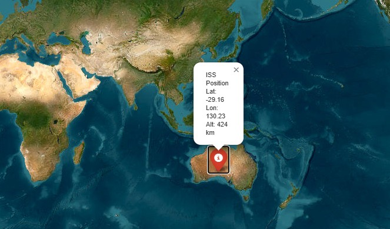

# Satellite orbit and earth observation


*Personal project - work in progress*

I am a Master's student in Applied Mathematics and Data Science.
I created this project to learn more about the space sector and to practice data science with real satellite data.
The main goal is to build a small Python project around satellite data, from orbital data to Earth observation images.

### View Notebook Online
You can view the main steps, outputs, and interactive maps directly in your browser:
- **[Interactive HTML Report](https://audrey-sid.github.io/satellite-orbit-earth-observation/notebooks/01_sentinel_analysis.html)**
- **[Jupyter Notebook File](notebooks/01_sentinel_analysis.ipynb)**

## What I am exploring

- TLE data parsing and SGP4 orbit propagation
- Interactive mapping with Folium
- Querying Sentinel-2 images via STAC API
- Image visualization and RGB spectral analysis
- NDVI index
- Machine learning applied to satellite imagery

## Technologies

Python, Git, GitHub, SGP4, Astropy, Folium, STAC API, Pillow, NumPy, Matplotlib

## About the project

This is a personal learning project. I will improve it step by step and add new parts as I learn more about satellite data and Earth observation.

## Project structure

```text
.
├── data/
│   └── raw/
│       ├── iss.txt
│       └── sentinel_kourou.jpg
├── notebooks/
│   └── 01_sentinel_analysis.ipynb
├── src/
│   ├── ingestion/
│   │   ├── load_tle.py
│   │   └── sentinel.py
│   ├── visualization/
│   │   └── view_image.py
│   └── orbital.py
├── .gitignore
├── map_preview.png
├── README.md
└── requirements.txt
```
